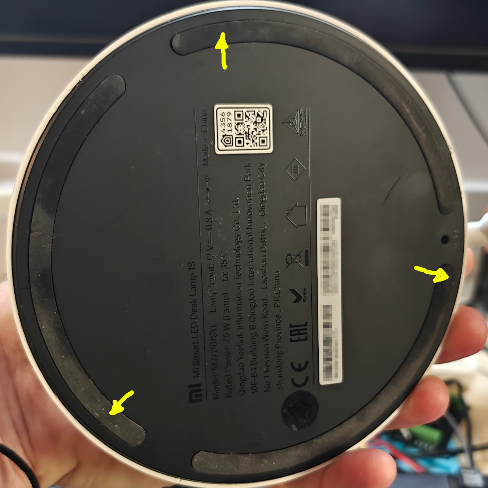
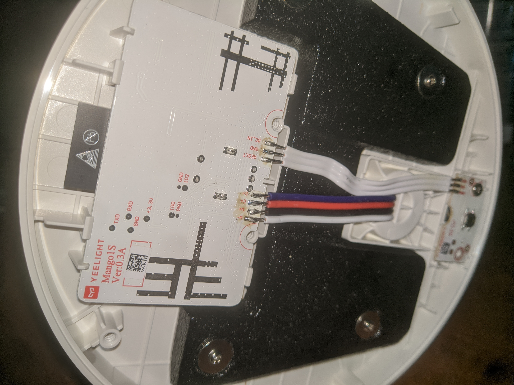
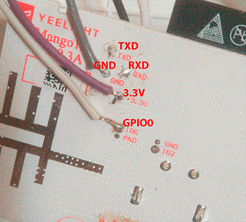

# Xiaomi Mi LED Desk Lamp 1S - Native Matter over Wi-Fi Firmware

Custom firmware for the **Xiaomi Mi LED Desk Lamp 1S** (`YEELIGHT Mango1S Ver:0.3A` / Model `MJTD01SYL`) providing native **Matter over Wi-Fi (MoW)** capability using Espressif's official `esp-matter` SDK and ESP-IDF.

---

## 💡 Features

* **Matter Protocol Support**:
  * Device Type: **Color Temperature Light** (`0x010C`).
  * Matter Clusters: `OnOff`, `LevelControl` (Brightness 1-100%), and `ColorControl` (Color Temperature: 2700K - 6500K / 153 - 370 mireds).
  * Native BLE Commissioning supported (Apple Home, Google Home, Home Assistant, SmartThings).
* **Hardware Optimized for Desk Lamp 1S**:
  * **FreeRTOS Unicore**: Built specifically for the single-core `ESP32-S0WD` / `ESP32-SOLO-1` processor inside the lamp (`CONFIG_FREERTOS_UNICORE=y`).
  * **240 MHz CPU & Hardware Crypto**: 240 MHz CPU clock with mbedTLS P-256 fixed-point acceleration for blazing fast PASE (~1.0s) and CSR (~0.29s).
  * **Zero Coil Whine**: 40 kHz PWM on cold (`GPIO2`) and warm (`GPIO4`) LED channels.
  * **Smooth S-Curve Fading**: 500ms cubic ease transitions for natural, flicker-free turn-on, turn-off, and level shifts.
  * **Power Rail Management**: Disables the hardware buck power rail (`GPIO12`) when off to eliminate standby noise and reduce quiescent current.
  * **Physical Controls**:
    * **Single Click**: Toggle lamp ON/OFF.
    * **Rotate Knob**: Adjust brightness (10% step per detent).
    * **Push & Rotate Knob**: Adjust color temperature (Warm / Cool).
    * **Bottom Pinhole Button (3 seconds hold)**: Flashes confirmation and performs a full Matter factory reset (clears pairing fabrics and enters commissioning mode).
  * **Visual Feedback**: Soft breathing indicator during commissioning mode, fast pulsing during active pairing, and 3 distinct flashes upon factory reset.
* **Over-The-Air (OTA) Updates**:
  * **Local Wi-Fi Web UI**: Once connected to Wi-Fi, the lamp hosts an HTTP OTA web server on port 80 at `http://<lamp-ip>/`.
  * Allows updating future firmware builds wirelessly without disassembling the lamp!
  * **Safe Dual-OTA Partitioning**: `ota_0` and `ota_1` (1,920 KB each) with automatic rollback protection.
* **Dynamic Hardware Identity**:
  * Serial number dynamically generated from hardware MAC address (`esp_read_mac`).

---

## 📱 Matter Pairing / Commissioning

Once flashed and powered on, the lamp enters commissioning mode automatically (breathing slowly).

| Method | Value |
| :--- | :--- |
| **Manual Pairing Code** | **`3497-011-2332`** |
| **Passcode** | `20202021` |
| **Discriminator** | `3840` (`0x0F00`) |
| **Setup QR Code Payload** | `MT:Y.K9042C00KA0648G00` |
| **Interactive Setup QR Code** | [Open Setup QR Code in Browser](https://project-chip.github.io/connectedhomeip/qrcode.html?data=MT%3AY.K9042C00KA0648G00) |

### Pairing Steps
1. Open your smart home app:
   * **Google Home**: Devices ➔ + Add ➔ Matter-enabled device ➔ Scan QR code or enter code `3497-011-2332`.
   * **Apple Home**: Add Accessory ➔ More options / Scan ➔ Enter code `3497-011-2332`.
   * **Home Assistant**: Add Integration ➔ Matter ➔ Commission device.
2. Select your Wi-Fi network and complete setup.

### 🏷️ Using a Custom Physical Sticker
If you have a physical Matter QR/code sticker from a spare device you wish to attach to the lamp, simply edit `kDiscriminator` and `kPasscode` at the top of `main/app_main.cpp`:
```cpp
static constexpr uint16_t kDiscriminator  = <YOUR_STICKER_DISCRIMINATOR>;
static constexpr uint32_t kPasscode       = <YOUR_STICKER_PASSCODE>;
```

---

## 🔍 Hardware Compatibility & Board Identification

Before flashing, **verify your lamp model and board revision**. Xiaomi has released multiple desk lamp generations that look nearly identical externally but use completely incompatible microcontrollers internally.

### Supported vs Unsupported Models

| Model | Marketing Name | Internal Board Silkscreen | Microcontroller | Matter Compatible? |
| :--- | :--- | :--- | :--- | :--- |
| **MJTD01SYL** | **Xiaomi Mi LED Desk Lamp 1S** | **YEELIGHT Mango1S Ver:0.3A** | **ESP32-S0WD / ESP-WROOM-32D** | ✅ **YES (This Project)** |
| MJTD01YL | Xiaomi Mi LED Desk Lamp (1st Gen) | YEELIGHT Mango Ver:... | ESP8266EX / ESP-WROOM-02D | ❌ **NO** (ESP8266 lacks RAM & BLE) |
| MJTD02YL | Xiaomi Mi Smart LED Desk Lamp Pro | Dual-arm PCB | ESP32 (Different GPIO pinout) | ❌ **NO** (Incompatible PWM/rails) |

> [!CAUTION]
> **Check your board before flashing!**  
> If your lamp is the older 1st Gen MJTD01YL (ESP8266), flashing an ESP32 binary will fail or permanently brick the device. Always open the base and check that the red silkscreen reads **YEELIGHT Mango1S Ver:0.3A**.

---

## 🛠️ Disassembly & Finding the Contact Pads

You do **not** need to remove the main PCB or disconnect any factory wiring harness to flash the firmware. The programming test pads are directly accessible on the bottom face of the PCB once the base cover is removed.

### Step 1: Open the Lamp Base
1. Place the lamp upside down on a soft towel or cloth to protect the finish.
2. Gently peel back the rubber foot strips at the **3 specific spots marked by the yellow arrows** in the image below to reveal the hidden **Phillips-head screws**.
3. Remove the 3 screws and gently lift off the bottom base cover.


*(Base screw locations photo courtesy of [zorruno.com](https://zorruno.com/2024/flashing-a-mi-home-1s-led-desk-lamp-with-esphome/))*



### Step 2: Locate the Programming Pads
On the exposed PCB, confirm the red silkscreen reads **YEELIGHT Mango1S Ver:0.3A**. Right next to the model markings, you will find circular gold-plated test pads clearly labeled on the silkscreen:



*(Hardware teardown and pinout diagram courtesy of [xoste49/MJTD01SYL](https://github.com/xoste49/MJTD01SYL))*


| Lamp Test Pad | USB-to-UART Adapter Pin | Function | Notes |
| :--- | :--- | :--- | :--- |
| **+3.3V** | **3.3V** | Power | ⚠️ **Use 3.3V only!** Connecting 5V will destroy the ESP32. |
| **GND** | **GND** | Ground | Common reference ground. |
| **TXD** | **RXD** | UART TX | Connects to Adapter Receive pin. |
| **RXD** | **TXD** | UART RX | Connects to Adapter Transmit pin. |
| **IO0** *(GPIO0)* | **GND** | Boot Mode | **Hold LOW (bridge to GND) while powering on** to enter flash mode. |

> [!TIP]
> **One-Time Wire Soldering:**  
> You only need serial wires for the initial flash! Once this Matter firmware is installed, all future firmware updates are performed wirelessly via the built-in [Local Wi-Fi OTA Web UI](#-wireless-over-the-air-ota-updates) (`http://<lamp-ip>/`). After flashing `merged-flash.bin` successfully, you can desolder all wires and reassemble the base.

## ⚡ Flashing the Lamp

### 1. Download the Precompiled Binary
Download `merged-flash.bin` directly from the [GitHub Releases](https://github.com/1LyRa/xiaomi-lamp-1s-matter/releases) page.

### 2. Enter Flash / Bootloader Mode
Wire your USB-to-UART adapter to the test pads on the lamp's base:
* **3.3V** ➔ 3.3V (Do **NOT** use 5V)
* **GND** ➔ GND
* **TX** ➔ Adapter RX
* **RX** ➔ Adapter TX
* **D0 / GPIO0** ➔ GND (held low at boot)

### 3. Flash the Merged Binary (One Command)
Run from terminal or command prompt:
```powershell
python -m esptool --chip esp32 --port COM3 --baud 921600 write-flash 0x0 merged-flash.bin
```
*(Replace `COM3` with your serial port, e.g. `/dev/ttyUSB0` on Linux/macOS).*

### 4. Normal Boot
1. Disconnect **D0 / GPIO0** from **GND**.
2. Power cycle the lamp (unplug and replug the 3.3V or main 12V barrel adapter).

---

## 🌐 Wireless Over-the-Air (OTA) Updates

Once the initial `merged-flash.bin` firmware is installed and connected to Wi-Fi, future firmware updates can be applied completely wirelessly:
1. Open `http://<lamp-ip>/` in any browser on your local network.
2. View device information (firmware version, serial number, uptime, free heap).
3. When new updates are released, upload the application `.bin` file directly in the web UI. The lamp flashes the update to the secondary OTA partition, verifies the slot, and reboots automatically with rollback protection.

---

## 🔄 Reverting to Factory Xiaomi Firmware

If you ever wish to restore the original stock Xiaomi cloud firmware, your backup can be restored anytime:
```powershell
python -m esptool --chip esp32 --port COM3 --baud 921600 write-flash 0x0 original_firmware_backup.bin
```

---

## 🙏 Credits & Acknowledgments

* Base disassembly guide and screw location photography courtesy of **[zorruno.com](https://zorruno.com/2024/flashing-a-mi-home-1s-led-desk-lamp-with-esphome/)**.
* Hardware teardown documentation and PCB pinout photography courtesy of **[xoste49/MJTD01SYL](https://github.com/xoste49/MJTD01SYL)**.
* Built with Espressif's official **[ESP-Matter SDK](https://github.com/espressif/esp-matter)** and **[ESP-IDF](https://github.com/espressif/esp-idf)**.
* Connectivity Standards Alliance (CSA) **[Matter Specification](https://csa-iot.org/all-solutions/matter/)**.

